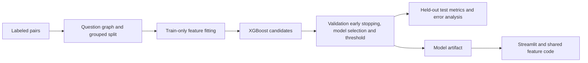

# Semantic Duplicate Question Detection

Predict whether two questions ask for the same thing. The project uses labeled [Quora Question Pairs](https://www.kaggle.com/competitions/quora-question-pairs/data) and serves validation-selected XGBoost and Siamese LSTM models in Streamlit.

- [V1](v1/README.md) reproduces the CampusX progression with symmetric bag-of-words, basic, and handcrafted feature sets. Its notebooks use the maintained training and evaluation workflow.
- [V2](v2/README.md) adds word and character TF-IDF and a sentence-embedding ablation. Training and the app share feature construction and the decision rule.
- [V3](v3/README.md) trains a shared TensorFlow/Keras LSTM with cosine triplet loss and compares random negatives with semi-hard mining.
- [Results](results/) contains measured metrics, the run configuration, confusion matrices, and evaluation curves. Training creates the model and the row-level error report locally.

## Run locally

Use Python 3.12. The pinned CPU dependencies were tested on Linux x86-64.

```bash
python -m venv .venv
source .venv/bin/activate
python -m pip install -r requirements.txt
python -m unittest discover -s tests -v
```

Follow the [dataset instructions](data/README.md) to put the labeled CSV at `data/train.csv`. From the repository root, train on all usable rows and launch the app.

```bash
python -m v2.quora_v2_pipeline
python -m streamlit run v2/app_v2.py
```

For the standalone V1 workflow, run `python -m v1.baseline` followed by `python -m streamlit run v1/app.py`. Use `--sample 12000 --max-trees 50 --output artifacts/smoke` for a quick V2 check. Each training invocation needs a new or empty output directory. Set `QUORA_MODEL_PATH` to a trusted local `model.joblib` to use a different run in the app.

For the Siamese LSTM, install the optional V3 dependencies with `python -m pip install -r requirements-v3.txt`, run `python -m v3.train`, then launch `python -m streamlit run v3/app.py`. [V3 architecture and reproducible commands](v3/README.md)

## Architecture and evaluation



1. Build connected components over question IDs and identical normalized text across the full input graph. Keep each component intact. Filter rows with empty model inputs, then allocate whole components toward 70/10/20 train/validation/test targets while balancing label counts. Check every split for disjoint components, question IDs, and normalized question text.
2. Fit bag-of-words and both TF-IDF vectorizers on the unique training questions. Canonically order each normalized pair before computing similarities and handcrafted features. The default sentence embedding projects word TF-IDF into up to 64 dimensions with training-only truncated SVD (latent semantic analysis, or LSA).
3. Train each XGBoost candidate with the same configuration. Use validation log loss for early stopping and model selection. Choose each candidate's classification threshold by validation F1 and classify probabilities at or above it as duplicates. Use the training duplicate prevalence for the constant-probability baseline and a fixed 0.5 threshold.
4. Measure accuracy, precision, recall, F1, ROC-AUC and log loss on the held-out test set. Confirm exact feature and probability equality under reversal for up to 256 test pairs per fitted model. Export the validation-selected artifact and up to 200 of its highest-confidence test mistakes.

## Results

The full input contained 404,290 labeled pairs. After filtering 23 rows with empty normalized question text, the run used **404,267 pairs** with seed 42 and no subsampling.

| Split | Pairs | Components | Duplicate pairs |
|---|---:|---:|---:|
| Train | 282,987 | 94,744 | 104,484 |
| Validation | 40,426 | 39,236 | 14,926 |
| Test | 80,854 | 66,258 | 29,853 |

| Experiment | Accuracy | Precision | Recall | F1 | ROC-AUC | Log loss |
|---|---:|---:|---:|---:|---:|---:|
| Train prior | 0.6308 | 0.0000 | 0.0000 | 0.0000 | 0.5000 | 0.6585 |
| BoW | 0.6690 | 0.5323 | 0.8517 | 0.6552 | 0.7667 | 0.5448 |
| BoW + basic | 0.7228 | 0.5826 | 0.8789 | 0.7008 | 0.8282 | 0.4745 |
| BoW + handcrafted | 0.7752 | 0.6468 | 0.8616 | 0.7389 | 0.8720 | 0.4160 |
| Handcrafted | 0.7720 | 0.6425 | 0.8618 | 0.7362 | 0.8698 | 0.4185 |
| TF-IDF | 0.7360 | 0.5956 | 0.8876 | 0.7129 | 0.8380 | 0.4730 |
| Handcrafted + TF-IDF | 0.7769 | 0.6476 | 0.8683 | 0.7419 | 0.8741 | 0.4125 |
| **Handcrafted + TF-IDF + LSA** | 0.7763 | 0.6426 | 0.8882 | 0.7457 | 0.8769 | 0.4095 |

Validation log loss selected **Handcrafted + TF-IDF + LSA** (0.3929). Its validation F1 threshold was 0.3383. Adding LSA to handcrafted and TF-IDF features improved test recall and log loss while slightly reducing precision and accuracy.

The selected model's test confusion counts were 36,252 true negatives, 14,749 false positives, 3,338 false negatives, and 26,515 true positives. Its 200 highest-confidence mistakes contained 20 false positives and 180 false negatives. Each fitted model returned exactly equal feature values and probabilities for 256 reversed test pairs.

[Ablation CSV](results/ablation_results.csv) · [Confusion matrices](results/confusion_matrices.png) · [Evaluation curves](results/evaluation_curves.png) · [Run metadata](results/run_summary.json)

### V3 and the full MiniLM comparison

All rows below use the same 80,854 grouped test pairs. The V3 CPU experiment used the full
282,987-pair training partition, up to 32 tokens per question, 64-dimensional embeddings
and LSTM state, and four epochs for each sampling strategy.

| Model | Accuracy | F1 | ROC-AUC |
|---|---:|---:|---:|
| V1 bag of words | 0.6690 | 0.6552 | 0.7667 |
| V2 handcrafted + TF-IDF + LSA | 0.7763 | 0.7457 | 0.8769 |
| V2 handcrafted + TF-IDF + MiniLM | 0.8512 | 0.8157 | 0.9300 |
| V3 Siamese LSTM · random negatives | 0.7199 | 0.6605 | 0.7952 |
| V3 Siamese LSTM · semi-hard negatives | 0.7175 | 0.6644 | 0.7969 |
| V3 Siamese LSTM · hard negatives | 0.7248 | 0.6620 | 0.7974 |

Hard mining had the highest V3 validation F1 (0.6849) and V3 test accuracy (72.48%).
Semi-hard mining had the highest V3 test F1 (0.6644).
The full MiniLM run had the highest measured F1 and ROC-AUC. The smaller MiniLM pilot is
reported separately. [Full comparison](results/v3/comparison.csv) · [V3 results and plots](results/v3/) · [MiniLM pilot](results/README.md#minilm-pilot)

## Limitations

- Component disjointness covers shared IDs and matching normalized strings. Differently worded versions of a question can still appear across splits, and the labels may reflect ambiguity or annotation noise.
- The LSA embeddings capture patterns from the training vocabulary. Pretrained MiniLM is available as a separate run with `--embeddings minilm` after installing [the optional dependencies](v2/README.md). A matched 4,000-pair pilot used a local copy of MiniLM. See the [pilot comparison](results/README.md#minilm-pilot).
- The public Kaggle test file has no labels. This report uses a held-out split from the labeled training file. Performance may change in another domain or under different duplicate rates.

## Attribution

CampusX's tutorial and companion repository inspired the V1 workflow and handcrafted features. The maintained baseline adapts them to grouped evaluation, train-only fitting, and order-invariant scoring. The Quora dataset is distributed separately through Kaggle. [CampusX tutorial](https://www.youtube.com/watch?v=1fvQU5yPjFs) · [CampusX source repository](https://github.com/campusx-official/quora-question-pairs) · [Quora Question Pairs on Kaggle](https://www.kaggle.com/competitions/quora-question-pairs)
