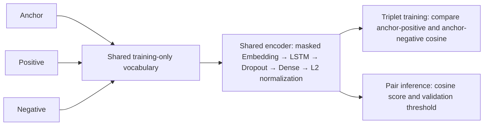

# V3 · Siamese LSTM

V3 trains a TensorFlow/Keras question encoder with triplet loss. It reuses the same normalized text, connected-component grouping, and seed-42 split as V1 and V2. The TensorFlow dependency is optional for the earlier versions.

## Run V3

Use Python 3.12. Follow the [dataset instructions](../data/README.md), then run from the repository root.

```bash
python -m pip install -r requirements-v3.txt
python -m unittest discover -s tests -v
python -m v3.train
python -m streamlit run v3/app.py
```

The default encoder uses a 30,000-token vocabulary, up to 64 tokens per question, 128-dimensional word embeddings, 128 LSTM units, a 128-dimensional projection, and dropout of 0.2. Training uses Adam with a starting learning rate of 0.001, batches of 128, and a triplet margin of 0.2. Training can use a CPU or a GPU visible to TensorFlow. The measured run used a CPU. See `python -m v3.train --help` for the configurable settings.

Reproduce the measured **full-data CPU experiment** with

```bash
CUDA_VISIBLE_DEVICES=-1 python -m v3.train --epochs 4 \
  --embedding-dim 64 --lstm-units 64 --projection-dim 64 --sequence-length 32
```

Reproduce the matched hard-negative run and open its model in the app with

```bash
CUDA_VISIBLE_DEVICES=-1 python -m v3.train --strategies hard --epochs 4 \
  --embedding-dim 64 --lstm-units 64 --projection-dim 64 --sequence-length 32 \
  --output artifacts/v3-hard
QUORA_V3_MODEL_DIR=artifacts/v3-hard/hard python -m streamlit run v3/app.py
```

For a quick pipeline check, use

```bash
CUDA_VISIBLE_DEVICES=-1 python -m v3.train --epochs 2 --train-limit 10000 \
  --eval-limit 2000 --embedding-dim 24 --lstm-units 24 --projection-dim 24 \
  --sequence-length 24 --threads 2 --output artifacts/v3-smoke
```

The smoke run samples after forming the full split. Its test scores use a smaller set of pairs. The training command can also run only one strategy, for example with `--strategies hard`. To continue a run, keep its original settings and output directory, add `--resume`, and increase `--epochs`. The epoch checkpoint restores the encoder and optimizer. A resumed run can differ from uninterrupted training because Keras dropout state and cached mining embeddings may be refreshed.

The app uses the strategy selected by validation F1 under `artifacts/v3/`. Set `QUORA_V3_MODEL_DIR=artifacts/v3/random` to load another trained artifact. Set `QUORA_V2_MODEL_PATH` to a trusted local V2 model to compare it in the interface.

## Architecture



The vocabulary is fitted on unique normalized **training** questions. Padding uses token 0 and is masked by the LSTM. Unknown tokens use ID 1. Inputs longer than the configured length are truncated. The three branches call the **same** encoder with the same weights. The encoder outputs a normalized sentence vector. During inference, cosine similarity is symmetric, and the app shows its value and the threshold separately.

## Training objective

For unit-length embeddings, cosine distance is $d(a,b)=1-\cos(a,b)$. The loss for a triplet with anchor $a$, positive $p$, and negative $n$ is

```text
max(0, d(a, p) - d(a, n) + margin)
= max(0, cosine(a, n) - cosine(a, p) + margin)
```

A triplet has zero loss once its positive is at least one margin closer to the anchor than its negative. Each epoch samples one triplet for each eligible anchor.

## Negative sampling and mining

Training pairs supply both orientations of each labeled edge. A positive must be an explicit duplicate edge. A negative must be an explicit non-duplicate edge involving the anchor. The pipeline excludes conflicting labels, identical-text negatives, and negatives connected by a path of explicit positive edges. A positive path can veto a negative, while positive samples still require a direct label. Anchors without both kinds of reliable neighbor are skipped. The broader split graph includes both labels and is only used for partitioning.

- **Random** samples a valid negative uniformly each epoch.
- **Hard** starts with random warm-up, then picks the valid candidate with the highest cosine similarity to its anchor.
- **Semi-hard** starts with the same warm-up. It picks the closest valid negative whose score is below the positive score and within the margin of it. If there is no such candidate, it uses a randomly sampled valid negative.

Mining refreshes training embeddings from the current encoder at the configured interval. It scores only candidate edges and avoids constructing a matrix of similarities between all questions. The measured comparison uses random, semi-hard, and hard sampling with the same initialization, training data, and hyperparameters.

## Measured results

The full experiment used **404,267 usable pairs** across the train, validation and test splits.
The 282,987 training rows contained 315,504 unique normalized questions. Of these, 22,222 were
eligible anchors, 293,282 were skipped, and 55,719 had a positive but lacked a valid negative.
The pool removed 26 conflicting relationships and vetoed 173 negative edges for identical text
or a positive path. Each strategy generated 88,888 triplets over four epochs. Semi-hard
mined 23,326 negatives. Hard mining selected 66,666 negatives across the three epochs after warm-up.

| V3 strategy | Best validation F1 | Test accuracy | Test F1 | Test ROC-AUC | Test PR-AUC |
|---|---:|---:|---:|---:|---:|
| Random | 0.6834 | 0.7199 | 0.6605 | 0.7952 | 0.6708 |
| Semi-hard | 0.6825 | 0.7175 | 0.6644 | 0.7969 | 0.6728 |
| Hard | **0.6849** | **0.7248** | 0.6620 | **0.7974** | **0.6753** |

**Hard negatives gave the highest validation F1** across the three strategies. Hard mining also
gave the highest V3 test accuracy and ROC-AUC. Semi-hard mining gave the highest V3 test F1.
All three models have 1,957,120 trainable parameters. The hard-negative checkpoint is saved
under `artifacts/v3-hard/hard` and can be loaded using the command above.

## Evaluation and files

Each epoch is scored on validation pairs. Validation F1 selects the checkpoint and its cosine threshold. The training loop reduces the learning rate and can stop early when validation F1 stalls. All choices are frozen before the test set is scored.

- [Matched comparison](../results/v3/comparison.csv) covers the full grouped test split. The [MiniLM pilot](../results/minilm_pilot.csv) is a separate 4,000-pair experiment with an 800-pair test split.
- [Metrics](../results/v3/metrics.csv) report accuracy, precision, recall, F1, ROC-AUC, trapezoidal PR-AUC, threshold, confusion counts, latency, and parameter counts. The latency columns measure pretokenized batch scoring and the median encoding time for one pretokenized pair on CPU.
- [Evaluation plots](../results/v3/evaluation_curves.png) include training loss, validation F1, ROC and precision–recall, threshold search, and cosine distributions. [Random and semi-hard confusion matrices](../results/v3/confusion_matrices.png) and the [hard-negative confusion matrix](../results/v3/hard_confusion_matrices.png) use frozen validation thresholds. [Hard-negative evaluation plots](../results/v3/hard_evaluation_curves.png)
- [Run metadata](../results/v3/run_summary.json) records the input hash, split fingerprints, settings, and triplet-pool counts. Training histories are available for [random](../results/v3/random_history.json) and [semi-hard](../results/v3/semi-hard_history.json), and [hard](../results/v3/hard_history.json). [Hard-negative run metadata](../results/v3/hard_run_summary.json)
- The run saves encoder weights, vocabulary, threshold, history, and checkpoints locally under `artifacts/v3/`. Each strategy also saves up to 100 false positives and 100 false negatives to a local `error_analysis.csv`.

Cosine similarity is a score from −1 to 1. It has no probability calibration, so V3 omits log loss. The model sees only anchors with reliable neighbors of both labels. This limits training coverage even though the complete training partition supplies the vocabulary and candidate graph. Results are from a single seed. Longer training, a wider encoder, and pretrained word embeddings are separate future experiments. Similar questions with different wording can still appear across partitions even when IDs and normalized strings are disjoint.

## CV summary

- Built a TensorFlow/Keras Siamese LSTM for duplicate-question detection using a shared encoder, cosine triplet loss, and a training-only vocabulary.
- Compared random, semi-hard, and hard negative sampling using 22,222 eligible anchors and a group-disjoint test set of 80,854 Quora question pairs.
- Built a Streamlit app for validation-selected cosine scoring and measured 0.7974 ROC-AUC for the hard-negative model, with exact score symmetry verified on 256 reversed test pairs.
